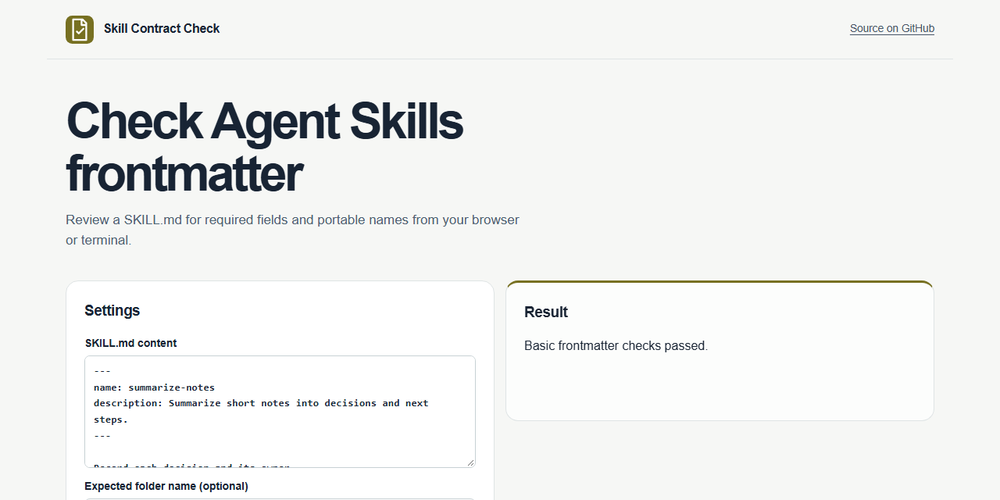

# Skill Contract Check

**Check Agent Skills frontmatter.** Review a SKILL.md for required fields and portable names from your browser or terminal.

[Open the live tool](https://musabukhari237.github.io/skill-contract-check/) · [Report an issue](https://github.com/MusaBukhari237/skill-contract-check/issues)

[](https://musabukhari237.github.io/skill-contract-check/)

## Try an example

Load a passing example and run the check. Change the expected folder name to see the mismatch finding.

## Usage and limits

Checks common single-line and block-scalar frontmatter for name and description, and optionally the folder name. This is a small lint pass, not a general YAML parser or a security audit. [Agent Skills specification](https://agentskills.io/specification)

Run `node check.mjs path/to/SKILL.md optional-folder-name` for the same basic checks in a terminal. An invalid skill exits with code 1.

## Run locally

Clone this repository, then run:

```sh
python -m http.server 8000 --bind 127.0.0.1 --directory docs
```

Open http://127.0.0.1:8000 in a browser. The site needs no package install. Run `node --test` with Node.js 22 or newer.

## Sponsors

Supported by [LeadCeleris](https://www.leadceleris.com/) and [AIFFICIENTO](https://www.aifficiento.biz/).

## Contributing and license

Use synthetic input in bug reports and contributions. See [contribution notes](CONTRIBUTING.md) and the [MIT license](LICENSE).
